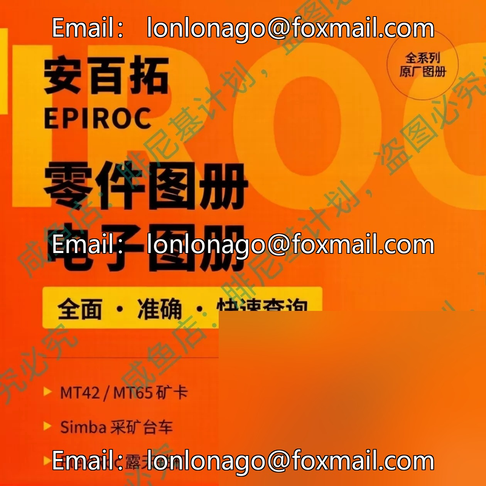

# # Mechanical aesthetics - Anbato

## Body

# Mechanical Aesthetics - Anbutao
[Fire] Pile engine machine	SpeedROC D30, SpeedROC 3F/2F/1F hydraulic hammer drilling machine
[Fire] Blasting platform machine / drilling machine	Boomer 281, Boomer L/E/XE/WE, Boomer S2 series (S2L/S2M/S2H)
[Fire] Open-door blasting drilling machine	FlexiROC T20 R, T30 R (building/cuttingsite version), T35/T35 R, T40
[Fire] Loading and handling	Minetruck MT431B/MT2200/MT2010, Scooptram ST14 diesel scraper-truck

[Fire] Other specialized equipment Haggloader 7HR/10HR scraper, Mobile Miner 22H/55V/40V coal miner, Cabletec M anchor rope equipment, ROC L8/L12, Simba 262/362 mining drill vehicle.
[Important Notice]

⚠️ Consult first, place order later!

ANBATO equipment is complex in configuration. And there exist configuration differences of the same model with different years. Please make sure to before placing an order Provide your specific model number. We will verify the inventory manually. Confirm that there are goods before sending them to you Eliminate incorrect shipping, Lost shipment!

[Purchase Instructions]

This product is an electronic PDF file, which is not refundable upon sale.

The content covers the mechanical aesthetics of Anbato, including pile machinery, rock-boring platforms/drills, open-top rock drilling machines, loading and transporting equipment, and other specialized equipment, while also mentioning the full series, original manuals, EPIROC querying, MT42/MT65 miner trucks, Simba mining platforms and FlexiRoc open-top drills, along with prompts for consultation before placing an order and machine verification.

<!-- AI_ENRICHED -->

## Images

## Payment

Here is a pay link on Stripe ( https://buy.stripe.com/3cs8yP7sY87d0vu9AB ). Please contact me lonlonago@foxmail.com after funding $89, and I will send you a complete data files , thank you!

